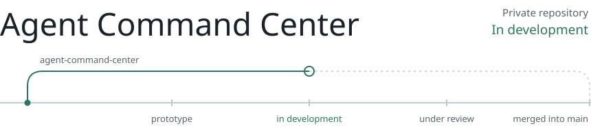
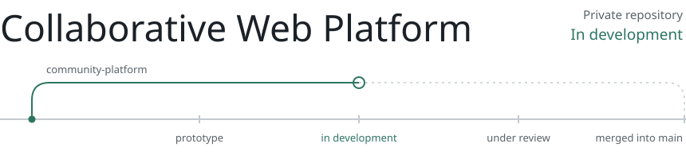
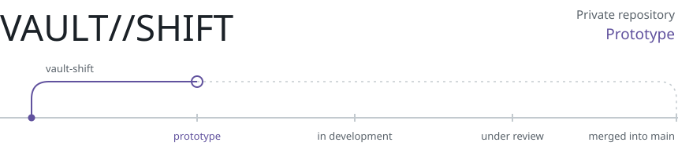

<picture>
  <source media="(max-width: 600px) and (prefers-color-scheme: dark)" srcset="assets/hero-mobile-dark.svg">
  <source media="(max-width: 600px)" srcset="assets/hero-mobile-light.svg">
  <source media="(prefers-color-scheme: dark)" srcset="assets/hero-dark.svg">
  
</picture>

<a href="#selected-work">Selected work</a> &nbsp; · &nbsp; <a href="#stack">Stack</a> &nbsp; · &nbsp; <a href="#now">Now</a> &nbsp; · &nbsp; <a href="#contact">Contact</a>

## About

I'm a computer science student at Unisinos in southern Brazil and, since August 2026, a software development intern at CABERGS. At work I build and maintain web applications with C#, ASP.NET Core and Razor Pages: responsive layouts, forms, REST API data in the interface, functional testing and bug fixing, shipped as small, focused Git changes.

Outside work, I build systems that connect product thinking with engineering: a collaborative web app, a multiplayer game and a local orchestrator for AI coding agents. Some implementation is AI-assisted, while I focus on setting requirements, testing behaviour, reviewing changes and keeping project claims honest.

I studied English in Toronto at ILAC and volunteer as a buddy for international students at Unisinos. In the long run I want to work as a software engineer abroad. Germany is high on my list, and I'm open to other countries too.

## Selected work

Three projects that represent what I am building right now. Each plate pairs a diagram of how the project works (drawn in code) with a track of its **maturity** (not literal Git merge status). Diagrams are illustrations, not screenshots. Expand each case study for verified work on `main`, changes still in review, and my role.

<!-- PROJECTS:START (generated by scripts/build.py from portfolio/projects.json, do not edit by hand) -->

<picture>
  <source media="(max-width: 600px) and (prefers-color-scheme: dark)" srcset="assets/projects/acc-mobile-dark.svg">
  <source media="(max-width: 600px)" srcset="assets/projects/acc-mobile-light.svg">
  <source media="(prefers-color-scheme: dark)" srcset="assets/projects/acc-dark.svg">
  
</picture>

A local dashboard that queues coding tasks, gives each one an isolated Git worktree and keeps every change on its own branch for human review.

**Status:** In development. The core runs on main with passing CI on Linux and Windows. About 60 follow-up pull requests are still drafts. It has not been tested with a real AI agent on a physical machine yet.  
**Stack:** Python, FastAPI, SQLite, Git worktrees, pytest, GitHub Actions

<b>Inside the project</b>

**On the main branch today**

- FastAPI app and dashboard that only accept requests addressed to localhost
- Task queue with status and logs stored in SQLite, plus cancel and pause
- One branch and one Git worktree per task; the orchestrator never pushes, merges or deploys
- Tests passing in CI on Linux and Windows against a simulated agent

**Not on main yet**

- Adapters for real agents, crash recovery, stronger isolation and a Windows launcher, spread across about 60 draft pull requests

**My role**

Personal project. I came up with the idea and set the requirements, priorities and safety rules. AI coding agents write most of the code through draft pull requests, and nothing reaches main without my approval.

**Engineering challenges**

- Giving an agent a working copy without giving it a path to main
- Keeping simulated CI results separate from real validation on a physical machine

**Code:** private repository. Happy to walk through it in an interview.

 

<picture>
  <source media="(max-width: 600px) and (prefers-color-scheme: dark)" srcset="assets/projects/community-mobile-dark.svg">
  <source media="(max-width: 600px)" srcset="assets/projects/community-mobile-light.svg">
  <source media="(prefers-color-scheme: dark)" srcset="assets/projects/community-dark.svg">
  
</picture>

A mobile-first community web app with posts, a paginated feed and shared boards where members propose clues and the author accepts them.

**Status:** In development. 22 pull requests are merged into integration branches, none into main yet. Not deployed.  
**Stack:** Next.js, React, TypeScript, Tailwind CSS, Supabase, Playwright

<b>Inside the project</b>

**On the main branch today**

Only the project scaffold so far. The features below live on integration branches.

**Not on main yet**

- Email sign-up, sign-in and password reset with Supabase Auth
- Posts, likes and comments in a paginated feed
- Database schema and row-level security policies on every table, managed as SQL migrations
- Unit, end-to-end and schema contract tests with Playwright

**My role**

Team project with a friend. I plan the work in rounds, write the requirements, split tasks across branches for my teammate and AI coding agents, and decide what gets merged.

**Engineering challenges**

- Writing row-level security rules so users can only change their own content
- Testing auth flows without depending on a live backend

**Code:** private repository. Happy to walk through it in an interview.

 

<picture>
  <source media="(max-width: 600px) and (prefers-color-scheme: dark)" srcset="assets/projects/vault-mobile-dark.svg">
  <source media="(max-width: 600px)" srcset="assets/projects/vault-mobile-light.svg">
  <source media="(prefers-color-scheme: dark)" srcset="assets/projects/vault-dark.svg">
  
</picture>

A multiplayer sci-fi arena game for Roblox. The design: two teams fight over energy cores while reshaping the map.

**Status:** Prototype. Server-side combat and the arena are on main. The core match loop and Blender models are in draft pull requests. Multiplayer, mobile and controller testing are pending. Not published.  
**Stack:** Luau, Roblox Studio, Rojo, Blender

<b>Inside the project</b>

**On the main branch today**

- Player-versus-player combat resolved on the server, with hit validation and rate limiting
- Combat HUD, health bars and hit effects on the client
- Arena map kept under version control as code through Rojo

**Not on main yet**

- Core match loop, animations, camera and weapons (draft)
- Blender-made models and robot armor imported into a private test place (drafts)

**My role**

Personal project. I came up with the game, write the design document and sprint goals, make the art direction calls and test builds in Roblox Studio. AI coding agents write the code through pull requests that I approve.

**Engineering challenges**

- Never trusting the client: range, angle and invalid input are checked on the server
- Keeping edits made inside Roblox Studio in sync with the repository

**Code:** private repository. Happy to walk through it in an interview.

 

### Earlier work

**[Gym Management System](https://github.com/mateuscengeroff-prog/gym-management-system)** · Python · SQLite · Matplotlib · Under review

I developed the original application **without AI tools**, deliberately, to test my own programming skills. Later maintenance, reliability fixes and automated tests were AI-assisted and reviewed; the current code is merged, with a Windows smoke test still pending.

<!-- PROJECTS:END -->

## Stack

| Where | Technologies |
|---|---|
| **At work** | C#, .NET, ASP.NET Core, Razor Pages, HTML, CSS, REST APIs, Git |
| **In my projects** | Python, C++, SQL, SQLite, Next.js, React, Supabase, FastAPI, Luau, GitHub |
| **Learning now** | TypeScript |

## Now

- Building review and isolation workflows for the Agent Command Center
- Developing the collaborative web platform on integration branches
- Iterating on VAULT//SHIFT's gameplay prototype
- Studying object-oriented C++, calculus and algebra at Unisinos

## On GitHub

Some projects remain private while development and security reviews continue. I prefer accurate case studies over inflated statistics, and link public code where it is ready.

## Contact

[LinkedIn](https://www.linkedin.com/in/mateus-engeroff-9774043ba/) is the best place to reach me. I read messages in English and Portuguese.

<picture>
  <source media="(max-width: 600px) and (prefers-color-scheme: dark)" srcset="assets/footer-mobile-dark.svg">
  <source media="(max-width: 600px)" srcset="assets/footer-mobile-light.svg">
  <source media="(prefers-color-scheme: dark)" srcset="assets/footer-dark.svg">
  
</picture>
