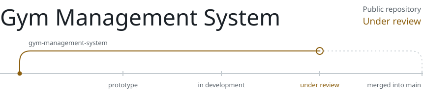

<picture>
  <source media="(prefers-color-scheme: dark)" srcset="assets/hero-dark.svg">
  
</picture>

## About

I'm a computer science student at Unisinos in southern Brazil and, since August 2026, a software development intern at CABERGS. At work I build and maintain web applications with C#, ASP.NET Core and Razor Pages: responsive layouts, forms, REST API data in the interface, functional testing and bug fixing, shipped as small, focused Git changes.

Outside work I pick projects that are a little too big for me, because that's where I learn the most: a community web app built with a team, a multiplayer Roblox game, and a local tool that keeps AI coding agents on a short leash. A lot of that work is AI-assisted, so I've had to get good at the parts that stay human: deciding what to build, writing clear requirements, checking what actually works, and not calling anything done before it's tested.

I studied English in Toronto at ILAC and volunteer as a buddy for international students at Unisinos. In the long run I want to work as a software engineer abroad. Germany is high on my list, and I'm open to other countries too.

## Projects

The line under each project shows how far it is from being merged into `main`. Each case study separates what is already on `main` from what is still in open pull requests. Statuses are updated by hand after a milestone is actually validated, not from commit activity.

<!-- PROJECTS:START (generated by scripts/build.py from portfolio/projects.json, do not edit by hand) -->

<picture>
  <source media="(prefers-color-scheme: dark)" srcset="assets/projects/acc-dark.svg">
  
</picture>

A local dashboard that queues coding tasks, gives each one an isolated Git worktree and keeps every change on its own branch for human review.

**Status:** In development. The core runs on main with passing CI on Linux and Windows. About 60 follow-up pull requests are still drafts. It has not been tested with a real AI agent on a physical machine yet.  
**Stack:** Python, FastAPI, SQLite, Git worktrees, pytest, GitHub Actions

<b>Case study</b>

**On the main branch today**

- FastAPI app and dashboard that only accept requests addressed to localhost
- Task queue with status and logs stored in SQLite, plus cancel and pause
- One branch and one Git worktree per task; the orchestrator never pushes, merges or deploys
- Tests passing in CI on Linux and Windows against a simulated agent

**In open pull requests, not merged yet**

- Adapters for real agents, crash recovery, stronger isolation and a Windows launcher, spread across about 60 draft pull requests

**My role**

Personal project. I came up with the idea and set the requirements, priorities and safety rules. AI coding agents write most of the code through draft pull requests, and nothing reaches main without my approval.

**Engineering challenges**

- Giving an agent a working copy without giving it a path to main
- Keeping simulated CI results separate from real validation on a physical machine

**Code:** private repository. Happy to walk through it in an interview.

 

<picture>
  <source media="(prefers-color-scheme: dark)" srcset="assets/projects/community-dark.svg">
  
</picture>

A mobile-first community web app with posts, a paginated feed and shared boards where members propose clues and the author accepts them.

**Status:** In development. 22 pull requests are merged into integration branches, none into main yet. Not deployed.  
**Stack:** Next.js, React, TypeScript, Tailwind CSS, Supabase, Playwright

<b>Case study</b>

**On the main branch today**

Only the project scaffold so far. The features below live on integration branches.

**In open pull requests, not merged yet**

- Email sign-up, sign-in and password reset with Supabase Auth
- Posts, likes and comments in a paginated feed
- Database schema and row-level security policies on every table, managed as SQL migrations
- Unit, end-to-end and schema contract tests with Playwright

**My role**

Team project with a friend. I plan the work in rounds, write the requirements, split tasks across branches for my teammate and AI coding agents, and decide what gets merged.

**Engineering challenges**

- Writing row-level security rules so users can only change their own content
- Testing auth flows without depending on a live backend

**Code:** private repository. Happy to walk through it in an interview.

 

<picture>
  <source media="(prefers-color-scheme: dark)" srcset="assets/projects/gym-dark.svg">
  
</picture>

A command-line app for managing gym members: registration, search, plan changes and reports with charts.

**Status:** Under review. A fix for a startup crash, 51 automated tests and new documentation are waiting in an open pull request. Until it is merged, main does not start.  
**Stack:** Python, SQLite, SQL, Matplotlib

<b>Case study</b>

**On the main branch today**

The original version, which crashes at startup because of a module that was never committed.

**In open pull requests, not merged yet**

- Create, list, search, edit and delete members, with input validation
- Reports for active and inactive members, members per plan, ages and gender, with Matplotlib charts
- Schema update routine that adds a column without dropping existing data
- A script that fills a demo database with fictitious members
- 51 automated tests, passing in CI on Python 3.10 to 3.13

Review: [mateuscengeroff-prog/gym-management-system/pull/1](https://github.com/mateuscengeroff-prog/gym-management-system/pull/1)

**My role**

Personal project. I wrote the original application. The audit, bug fixes and tests in the open pull request were done with an AI assistant and are waiting for my review.

**Engineering challenges**

- Changing the database schema on an existing file without losing records
- Separating input handling, database access and reports into modules

**Code:** [mateuscengeroff-prog/gym-management-system](https://github.com/mateuscengeroff-prog/gym-management-system)

 

<picture>
  <source media="(prefers-color-scheme: dark)" srcset="assets/projects/vault-dark.svg">
  
</picture>

A multiplayer sci-fi arena game for Roblox. The design: two teams fight over energy cores while reshaping the map.

**Status:** Prototype. Server-side combat and the arena are on main. The core match loop and Blender models are in draft pull requests. Multiplayer, mobile and controller testing are pending. Not published.  
**Stack:** Luau, Roblox Studio, Rojo, Blender

<b>Case study</b>

**On the main branch today**

- Player-versus-player combat resolved on the server, with hit validation and rate limiting
- Combat HUD, health bars and hit effects on the client
- Arena map kept under version control as code through Rojo

**In open pull requests, not merged yet**

- Core match loop, animations, camera and weapons (draft)
- Blender-made models and robot armor imported into a private test place (drafts)

**My role**

Personal project. I came up with the game, write the design document and sprint goals, make the art direction calls and test builds in Roblox Studio. AI coding agents write the code through pull requests that I approve.

**Engineering challenges**

- Never trusting the client: range, angle and invalid input are checked on the server
- Keeping edits made inside Roblox Studio in sync with the repository

**Code:** private repository. Happy to walk through it in an interview.

 

<!-- PROJECTS:END -->

## Stack

| Where | Technologies |
|---|---|
| **At work** | C#, .NET, ASP.NET Core, Razor Pages, HTML, CSS, REST APIs, Git |
| **In my projects** | Python, C++, SQL, SQLite, Next.js, React, Supabase, FastAPI, Luau, GitHub |
| **Learning now** | TypeScript |

## Now

- Reviewing the fixes and tests for `gym-management-system` before merging them
- Adding review and isolation gates to the Agent Command Center before enabling its first real agent
- Learning TypeScript through the community platform
- Second semester of computer science: object-oriented C++, calculus and algebra

## On GitHub

Most of my work lives in private repositories, so the public repository list is short on purpose. I don't show third-party stats cards here: several of my projects use AI coding agents that commit through my account, and commit counts would mix that activity with my own. The case studies above say exactly what I did on each project.

## Contact

[LinkedIn](https://www.linkedin.com/in/mateus-engeroff-9774043ba/) is the best place to reach me. I read messages in English and Portuguese.

<picture>
  <source media="(prefers-color-scheme: dark)" srcset="assets/footer-dark.svg">
  
</picture>
